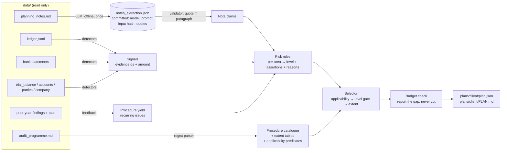

# Architecture: Thornbury planning engine

Working notes, not the submission. `starter-ts/DESIGN.md` (≤500 words) gets distilled from this.

> **Written before the build (5 November).** Kept as a record of the plan. Where it differs from the code, `starter-ts/DESIGN.md` and the code are authoritative: rules, thresholds and numbers have moved since.

## Principle

**Facts are computed, judgment is written down as rules, and the language model only reads prose.**
Every risk level and every selection comes from deterministic code. That code runs over the file plus one committed, validated artefact: the notes extraction. The same inputs produce the same `plan.json`, byte for byte, in 2028 and without an API key (memo 5).

## Components

### 1. Programme parser (`src/programme.ts`), deterministic
- The markdown is regular: `### ID Title`, then the `**Assertions:** … · **Level:** … · **Hours:** … · **Scalable:** …` line, then `**Applicability:**`, then the description. A regex parser covers it, and no LLM is needed.
- It also extracts **per-procedure sample tables** ("10 at baseline, 20 at elevated, 40 at significant"). The general 15/25/40 table applies only when a procedure quotes none: REV-02 and JNL-01 differ from it.
- **Applicability → predicates.** This is a hand-written table of 40 entries, `{procedureId, predicate(facts) → {applies, because, evidenceIds}}`. Each entry quotes the prose it implements. It is code because applicability is firm policy and has to be reviewable line by line. A test asserts that every parsed procedure has a predicate, so a new procedure in the programme fails loudly.
- Tests: 40 procedures, 14 areas, every field present, and the REV-02 and JNL-01 tables are read from their own text.

### 2. Evidence index (`src/evidence.ts`)
- One map from id to a human-readable record, built from vouchers, bank line ids, N# notes, prior-year finding ids, account codes and party ids.
- **Integrity rule:** any reason whose evidenceId does not resolve is a build error. This enforces memo 1 ("if it cannot point, it does not count") mechanically.
- PLAN.md renders each id with its one-line summary (voucher date, poster, amount, description; note text excerpt).

### 3. Detectors (`src/detectors/*.ts`), deterministic, client-agnostic
Each detector is a pure function `(file) → Signal[]`, where `Signal = {detector, area, assertions, amountMinor, evidenceIds, text, flags}`. No detector names a client. That is the memo 9 test.

| Detector | Feeds area | Why it exists (example hit) |
|---|---|---|
| Journal profile: manual, keyed after YE and posted before it, no approver, senior-management poster, round sum, out of hours, touches revenue or bank | journals, revenue | Ashworth MJ-000024 £187.5k revenue keyed 11.02.26 into 30.12.25 |
| Bank ↔ ledger match (multiset by amount/date; payroll matched as the sum of per-employee lines against one ledger line) | bankCash | Ashworth MJ-000019 £9.5k "Transfer" has no bank line, and the statement differs from the TB by exactly that |
| Leaver paid after end date (bank counterparty name ↔ party name; payroll in the ledger carries no party) | payroll | Ashworth Callum Reed, Jul–Dec |
| Approval limits: clustering in [90%, 100%) of a limit, self-approval, new supplier in year | purchasesCreditors | Ashworth Wharfedale 9/9 just under £10k; Calder and Wetherby self-approval |
| Related parties: transactions with RP-flagged parties, director balances (1150/2310), personal-address or keyword hits on expense lines | relatedParties | Ashworth refurb £24k to Ashworth Property, advance £35k; Calder kitchen at a home address |
| TB analytics: movement vs PY above min(PM, 10%), TB ↔ ledger tie-out, unbalanced vouchers, non-standard accounts | all | Ashworth debtors ×4, PI-000776, MISC-OPS |
| Classification: loan exists but interest account is zero; hospitality words outside the entertaining account with VAT reclaimed | goingConcern, vat | Calder interest in bank charges (covenants); Ashworth client dinner in 7500 |
| Takings series: missing or duplicate periods, weeks below the pattern | revenue | Calder weeks 19, 20, 33 missing |
| Estimates not booked: provision or accrual unchanged or zero, depreciation flat despite additions | accrualsProvisions | Wetherby provisions 0; depreciation equal to PY after a £45.6k addition |

All detector thresholds come from engagement materiality (clearly trivial, PM), not constants.

### 4. Notes extraction (`notes/`), the only place an LLM runs
- **Task:** for each N# paragraph, return a list of `{noteId, area, assertions, direction: raises|lowers|context, claim, quote}`.
- **Why an LLM:** "Kate looked at the floor" and "he'll put it right" carry the judgment in prose (memo 7). A keyword map misses them or over-fires.
- **Committed artefact:** `starter-ts/data/derived/<client>/notes_extraction.json` with `{model, promptSha256, prompt, inputSha256 (notes file), createdAt, items}`. The prompt lives in `src/llm/prompt.ts` and the raw response is stored too.
- **Validation (the "how do you know it's right"):**
  1. `quote` must be an exact substring of the paragraph's text;
  2. `area` and `assertions` must be in the enums;
  3. every paragraph is covered, or marked `context`;
  4. at runtime, if the notes file hash ≠ `inputSha256`, `plan` refuses to run and says to re-extract. No silent re-run.
- **Where the LLM does not belong:** risk levels, selection, extent, hours, arithmetic and anything about ledger facts. It also never writes rationale text that the partner reads as the engine's conclusion: the rationale is assembled from rule ids and evidence.
- **Spot check for the doc:** I review the extraction once by hand for one client and record the disagreements.

### 5. Prior-year feedback (`src/feedback.ts`) (memo 8)
- **Procedure yield** = misstatements raised / actual hours.
  - **Zero yield with an overrun** caps extent at baseline and requires a documented reason to extend (FA-01: 30h for 0 misstatements).
  - **Positive yield** makes the procedure a candidate to keep or extend.
- **Missed coverage:** a finding raised by procedure X when procedure Y covers it more directly ("surfaced by chance") forces Y to be considered next year. Examples: PAY-02 (FY24-14 via PAY-01) and RP-03 (FY24-03 via JNL-01). The data's `note` field makes this explicit.
- **Recurrence:** if a prior-year finding (misstatement, or a management-letter point "addressed") has a same-type detector hit this year, the area is raised, and the reason cites both ids. Examples: director advance, leaver, entertaining VAT, cut-off.

### 6. Risk rules (`src/risk.ts`)
- Rule table: `{ruleId, area, when(signals, claims, feedback, facts), level, assertions, reasonTemplate}`. The area's level is the max over the rules that fired, and its assertions are the union. Each fired rule becomes a reason with evidenceIds.
- **notApplicable** comes from facts, never from a lack of signals: no stock account, not VAT registered (no VAT accounts or tax codes in use), not first year.
- **ISA 240 presumptions:**
  - Management override is always at least elevated.
  - Revenue fraud risk is presumed significant unless rebutted. The rebuttal is an explicit rule with its reason, so Wetherby's NHS income (fixed 1/12 monthly) is a rebuttal candidate while the clawback estimate is not.
- `RULESET_VERSION` is written into the plan.

### 7. Selector, extent, omissions (`src/select.ts`)
For each procedure, in programme order:
1. If applicability is false: record as not selected, with the reason "does not apply: <predicate because>". Not counted as an omission (programme rule).
2. If the procedure is mandatory: select it.
3. If area level ≥ procedure level: select it. Otherwise record an **omission** whose reason names the area level, the rules that set it and the evidence. Memo 3: an omission is a reason, not a blank.
4. **Extent:** use the procedure's own table, then the general table. Then append **must-test items** from the signals as explicit vouchers (for example, JNL-01 = 30 + {MJ-000016, MJ-000019, MJ-000024}). Hours scale linearly with sample size per the programme. Feedback caps apply.

### 8. Budget (`src/budget.ts`)
- `totalHours` vs `budgetHours`. If over, nothing is cut (memo 2). Instead the plan carries `budgetGap` and a ranked **deferral menu**: non-mandatory selections sorted by (risk level asc, yield asc), each with its consequence. It is the partner's call.
- If under, the plan says so and does not pad.

### 9. Output
- `plan.json` is `AuditPlan` plus `signals`, `ruleFirings`, `budgetGap`, `deferralMenu`, `inputs: {sha256 per file}`, `rulesetVersion`, `extractionRef`. Arrays are sorted and there are no timestamps.
- `PLAN.md` is what Ingrid reads:
  1. headline: budget vs need, and the significant risks;
  2. per area: level, assertions, reasons with evidence one-liners, then the procedures selected (extent, hours, must-test items) and the procedures omitted (why);
  3. limitations and questions.
  The demo path is: area → level → rule → evidence → procedure.

## Determinism (memo 5)
- No `Date.now()` and no randomness; every collection is sorted.
- Input hashes are recorded. The LLM output is a committed file and validated against those hashes.
- **Golden test:** `plan all` reproduces the committed `plans/` exactly.

## Memo coverage: what goes in code vs the doc
| Memo | Where |
|---|---|
| 1 evidence | code (integrity rule) |
| 2 select + budget gap | code |
| 3 omissions | code |
| 4 risk ≠ size | code (feedback cap, FA-01) + doc |
| 5 reproducibility | code (hashes, cache, golden test) |
| 6 ledger | code (detectors) |
| 7 notes | code (validated extraction) |
| 8 learn | code (yield, missed coverage, recurrence) |
| 9 next client | code (no client names in detectors/rules) + test on Wetherby |
| 10 missing | doc: sale-process pressure (Ashworth N2) as a fraud-risk factor; management-letter follow-up tracking; evidence integrity as a product feature; outcome capture after fieldwork to close the loop |

## Questions for Ingrid (draft)
1. Revenue fraud presumption: rebut for Wetherby NHS income (fixed monthly) but not for the clawback?
2. Wetherby Q1 2026 statement has no receipts at all and ends on 9 Feb. Is it incomplete, or did something happen? Also, why is there an "HMRC VAT Q4 2025" line for an exempt practice?
3. Extent conflicts: the general 15/25/40 table vs procedure-specific tables. Is the procedure's own table authoritative?
4. FA-02 "register not verified in three years": the file holds no verification history. Treat it as unknown → ask?
5. Calder covenants: does the bank compute EBITDA from audited figures with interest reclassified out of bank charges?
6. Ashworth: given the sale, is Brightwater MJ-000024 a matter to raise with the MD before fieldwork?
7. Can the plan go to her over budget, with a deferral menu, or does she want a fitted variant too?

## Accuracy: what raises it, in order of payoff

Accuracy here means three things: recall of real risks, precision (no hours where there is no risk, memo 4), and every reason resting on the file.

1. **Full-population analytics in code, not sampling.** The whole ledger is available (memo 6). Almost every strong finding in `DATA-REVIEW.md` came from plain code: the leaver paid via the bank, the £9.5k "Transfer" with no bank line, Wharfedale just under the limit, Brightwater keyed after the year end. An LLM would not find these.
2. **Triangulation: contradictions are the strongest signal.** Compare what the client says with the ledger, the bank and the prior year. Examples: the bank says "4 days overdrawn" but the statement shows May–June and September; "nothing changes" at Wetherby, yet depreciation is flat after a £45.6k addition. These are ISA 240 inconsistency indicators. The LLM extracts claims from the notes, code checks them against the data, and a mismatch becomes a reason that cites both sides.
3. **Backtest on the prior year.** FY24 findings with outcomes (misstatement / explained / notAnException) are the only labelled data we have. Run the detectors and rules on FY24-shaped facts. Would they have caught the misstatements, and stayed quiet where the outcome was notAnException (FA-01)? Report recall and precision per rule. This is the one honest accuracy metric, and it goes in the demo.
4. **Held-out client.** Tune the rules on Ashworth and Calder, and do not look at Wetherby output until the end. Memo 9: we are judged on the least-tuned client.
5. **LLM only with verification:**
   - each claim carries an exact quote, checked as a substring;
   - every field is checked against the enums;
   - **self-consistency:** three runs, or two models; the plan uses what they agree on, and disagreements become questions for Ingrid;
   - the model gets the whole document in context, not one paragraph at a time, so that N11 ("Kate looked at the floor") links to the self-approval control.
6. **Thresholds from the engagement's materiality**, never constants. This is what lets the rules transfer to the next client.
7. **Explicit "cannot assess"** (for example, the Wetherby Q1 statement with no receipts). It goes to limitations and questions; the engine does not guess.
8. **Optional: an LLM devil's-advocate review** of the finished plan, looking for missed risks. Its output is suggestions with evidence ids only; it never changes the plan.

**Not doing:**
- an LLM deciding risk levels or selections;
- RAG or embeddings (the data is a few KB);
- fine-tuning (labelled examples number in the tens).

## Models / API

One API, for notes extraction only. Everything else is deterministic code.

| Role | Model | Notes |
|---|---|---|
| Notes → claims JSON (primary) | **Claude Opus 5.5**, `claude-opus-5-5` ($4 / $20 per MTok) | Structured outputs via `output_config.format`, adaptive thinking, effort `high` |
| Cross-check (self-consistency) | **Claude Sonnet 5.5**, `claude-sonnet-5-5` ($2 / $10) | A second, independent extraction; disagreements → questions |
| Devil's-advocate review (optional) | Claude Opus 5.5 | Suggestions only |

- **Access:** direct Anthropic API with the research key (from the environment, never committed). Both models were tested on 2026-11-05 and returned HTTP 200.
- **Cost:** the notes total about 12K tokens, so 3 clients × 3 runs is of the order of $1–2.
- **Reproducibility (memo 5, and the brief's rule for submissions):** commit the raw responses, the prompt, the model id and the input hash. `plan` reads only the committed file, so reviewers need no key.

## Deliberately deferred
- An interactive viewer (PLAN.md is enough per the brief).
- Statistical sampling and actual sample selection beyond must-test lists.
- An LLM for anything outside notes extraction.
- Parsing the programme's free text into structured "when it applies" logic (the hand-mapped predicates replace it).
